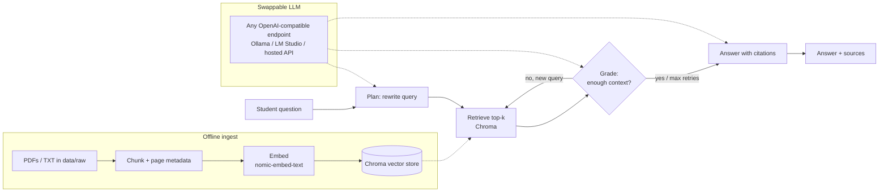

# IIUM Course Assistant

An **agentic RAG** assistant that answers questions about IIUM courses, handbooks and academic rules — with page-level citations — running on a **small local LLM** (via Ollama) so student data never leaves your machine.

> "Can I take INFO 4303 without the prerequisite?"
> → searches the handbook, checks whether what it found actually answers the question, searches again if not, then answers and cites `[1] student-handbook.pdf, p.42`.

## Why agentic (not plain RAG)?

Plain RAG retrieves once and hopes for the best. This agent:

1. **Plans** — rewrites the question into a good search query
2. **Retrieves** — top-k chunks from a local vector store
3. **Grades** — asks the LLM whether the excerpts are actually enough
4. **Retries** — if not, writes a new query and searches again (bounded loop)
5. **Answers** — only from the excerpts, with citations, or says it couldn't find it

## Architecture



The LLM sits behind one small class (`app/llm.py`) that talks to **any OpenAI-compatible endpoint**, so switching from a local Qwen to Llama or a hosted model is a one-line `.env` change.

## Quickstart

**Requirements:** Python 3.10+, [Ollama](https://ollama.com)

```bash
# 1. Pull the models (~5 GB total, runs on an 8 GB laptop)
ollama pull qwen2.5:7b          # or qwen2.5:3b on weaker machines
ollama pull nomic-embed-text

# 2. Install
git clone https://github.com/<your-username>/iium-course-assistant.git
cd iium-course-assistant
python -m venv .venv && source .venv/bin/activate   # Windows: .venv\Scripts\activate
pip install -r requirements.txt
cp .env.example .env

# 3. Add documents (handbook, course outlines, academic calendar) to data/raw/
python -m app.ingest

# 4. Ask
python -m app.cli "What is the minimum CGPA to avoid probation?" --trace

# or run the API
uvicorn app.main:app --reload    # then POST /ask {"question": "..."}
```

## Project structure

```
app/
  config.py      settings from .env
  llm.py         swappable OpenAI-compatible LLM client
  embeddings.py  Ollama embeddings
  text.py        chunking, JSON parsing, context formatting (pure, unit-tested)
  ingest.py      PDF/TXT → chunks → Chroma
  retriever.py   vector search
  agent.py       plan → retrieve → grade → retry → answer loop
  cli.py         command-line interface
  main.py        FastAPI server
tests/           unit tests (run in CI)
data/raw/        your documents (git-ignored)
```

## Roadmap

- [ ] **Evaluation set** — 30–50 real questions with expected answers; measure accuracy and citation correctness
- [ ] **Model comparison** — same eval across qwen2.5:3b / 7b, llama3.1:8b and a hosted model (speed vs. accuracy table)
- [ ] **Hybrid search** — add BM25 keyword search for course codes like `INFO 4303`
- [ ] **Bahasa Melayu** support
- [ ] **Web UI** (Streamlit or a simple React page)
- [ ] Docker compose for one-command setup

## A note on documents

University documents are not included in this repo. Put your own copies in `data/raw/` (git-ignored) and check that you're allowed to use them before deploying publicly.

## License

MIT
