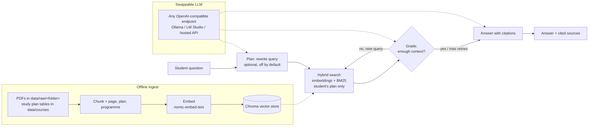

# IIUM Course Assistant

An **agentic RAG** assistant that answers questions about IIUM courses, handbooks and academic rules — with page-level citations — running on a **small local LLM** (via Ollama) so student data never leaves your machine.

> "Can I take INFO 4303 without the prerequisite?"
> → searches the handbook, checks whether what it found actually answers the question, searches again if not, then answers and cites `[1] student-handbook.pdf, p.42`.

## Why agentic (not plain RAG)?

Plain RAG retrieves once and hopes for the best. This agent:

1. **Plans** (optional) — rewrites the question into a keyword query, searched along with the question itself. Off by default (`QUERY_REWRITE=true` turns it on): in the eval it got no more answers right and cost an extra LLM call
2. **Retrieves** — hybrid search (embeddings + BM25 keywords) over the student's own study plan and the university-wide rules
3. **Grades** — asks the LLM whether the excerpts are actually enough
4. **Retries** — if not, writes a new query and searches again (bounded loop)
5. **Answers** — only from the excerpts, citing them as `[1]`, `[2]`, or says it couldn't find it. When an excerpt gives a rule per batch ("Batch 201: at least 130 credit hours"), it is also told the student's study plan (batch 211 follows study plan Batch 201), so it uses the right one. Told it for every question, the model mistook general rules for study plan ones. The sources list shows only the excerpts the answer cites, and a citation to an excerpt that doesn't exist is removed

## Architecture



The LLM sits behind one small class (`app/llm.py`) that talks to **any OpenAI-compatible endpoint**, so switching from a local Qwen to Llama or a hosted model is a one-line `.env` change.

## Quickstart

**Requirements:** Python 3.10+, [Ollama](https://ollama.com)

```bash
# 1. Pull the models (~5 GB total, runs on an 8 GB laptop)
ollama pull qwen2.5:7b          # or qwen2.5:3b on weaker machines
ollama pull nomic-embed-text

# 2. Install
git clone https://github.com/<your-username>/iium-course-assistant.git
cd iium-course-assistant
python -m venv .venv && source .venv/bin/activate   # Windows: .venv\Scripts\activate
pip install -r requirements.txt
cp .env.example .env

# 3. Download the documents listed in sources.md into the folder shown for each
#    (data/raw/all/, data/raw/bcs-241/, ...). The folder says which students a
#    document applies to. Study plan course tables and semester plans come from
#    data/courses/*.csv.
python -m app.ingest

# 4. Ask (programme and batch pick the right study plan)
python -m app.cli "What is the minimum CGPA to avoid probation?" --programme BCS --batch 241 --trace

# or run the API
uvicorn app.main:app --reload    # then POST /ask {"question": "...", "programme": "BCS", "batch": 241}

# check retrieval against the eval questions
python scripts/check_retrieval.py

# run the eval: every question through the agent, answers scored on key facts
# (variants: no-rewrite = the default settings, agentic = with query rewrite,
#  plain = plain RAG, strict)
python scripts/run_eval.py --model qwen2.5:7b --variant no-rewrite
```

Ollama runs models with a 4096-token context window by default and silently cuts longer prompts, so the agent keeps the excerpts it sends under `MAX_CONTEXT_CHARS` (see `.env.example`).

## Project structure

```
app/
  config.py      settings from .env
  llm.py         swappable OpenAI-compatible LLM client
  embeddings.py  Ollama embeddings
  text.py        chunking, batch → study plan, keyword search, JSON parsing, citations (pure, unit-tested)
  ingest.py      PDFs + study plan CSVs → tagged chunks → Chroma
  retriever.py   hybrid search (embeddings + BM25), filtered by study plan
  agent.py       plan → retrieve → grade → retry → answer loop
  scoring.py     eval scoring: key facts in answers, citations and context (pure, unit-tested)
  cli.py         command-line interface
  main.py        FastAPI server
scripts/
  extract_tables.py     study plan course tables → data/courses/<plan>.csv
  extract_semesters.py  study plan semester pages → data/courses/<plan>-semesters.csv
  check_retrieval.py    how often search finds the answer to each eval question
  run_eval.py           eval questions through the agent, scored; one CSV per run
tests/           unit tests (run in CI)
eval/            evaluation questions with expected answers, key facts and sources;
                 results/ holds each run's scores and a summary
data/courses/    study plan course tables and semester plans, extracted and hand-checked
data/raw/        your documents (git-ignored)
```

## Roadmap

- [ ] **Evaluation set** — 30–50 real questions with expected answers; measure accuracy and citation correctness
- [ ] **Model comparison** — same eval across qwen2.5:3b / 7b, llama3.1:8b and a hosted model (speed vs. accuracy table)
- [x] **Hybrid search** — BM25 keyword search alongside embeddings, for course names and codes like `BIIT 4321`
- [ ] **Bahasa Melayu** support
- [ ] **Web UI** (Streamlit or a simple React page)
- [ ] Docker compose for one-command setup

## A note on documents

University documents are not included in this repo. `sources.md` lists each one with its official link; put your own copies in `data/raw/<folder>/` (git-ignored) and check that you're allowed to use them before deploying publicly.

## License

MIT
