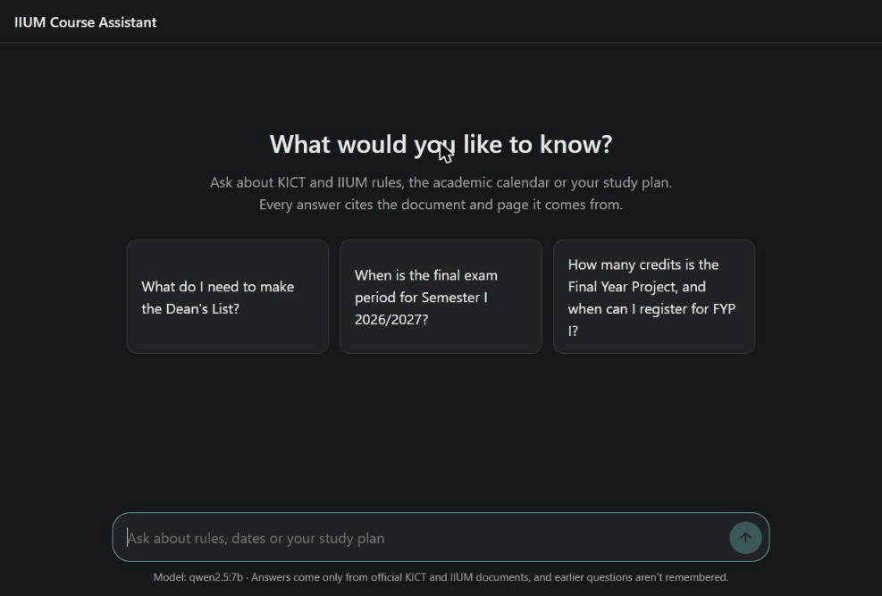
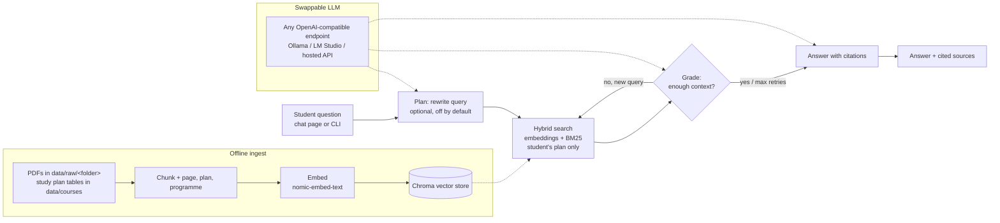

# IIUM Course Assistant

An **agentic RAG** assistant that answers questions about IIUM courses, handbooks and academic rules — with page-level citations — running on a **small local LLM** (via Ollama) so student data never leaves your machine.

> "Can I take INFO 4303 without the prerequisite?"
> → searches the handbook, checks whether what it found actually answers the question, searches again if not, then answers and cites `[1] student-handbook.pdf, p.42`.

## Web UI



*Sped up. Recorded on qwen2.5:7b on a laptop; each answer shows how long it really took.*

A chat page (React, TypeScript, Vite) on top of the FastAPI server:

- **Asks who you are first.** The rules depend on your study plan, so before it searches, the assistant asks for your programme (BCS or BIT) and batch. A matric number works too, and only its batch is sent (2410123 → 241)
- **Citations you can check.** Each `[n]` in an answer links to its source, and each source opens the PDF at the cited page
- **Says when it doesn't know.** If the documents don't answer the question, it says so instead of guessing
- **Shows its work.** "How it found this" lists the agent's steps: each search, grade and retry
- **Counts while it searches.** An answer takes about 16 s on qwen2.5:7b on a laptop, so the page shows the seconds as they pass

Each question is answered on its own: the chat remembers your programme and batch, not your earlier questions. To run it, see [Quickstart](#quickstart).

## Why agentic (not plain RAG)?

Plain RAG retrieves once and hopes for the best. This agent:

1. **Plans** (optional) — rewrites the question into a keyword query, searched along with the question itself. Off by default (`QUERY_REWRITE=true` turns it on): in the eval it got no more answers right and cost an extra LLM call
2. **Retrieves** — hybrid search (embeddings + BM25 keywords) over the student's own study plan and the university-wide rules
3. **Grades** — asks the LLM whether the excerpts are actually enough
4. **Retries** — if not, writes a new query and searches again (bounded loop)
5. **Answers** — only from the excerpts, citing them as `[1]`, `[2]`, or says it couldn't find it. When an excerpt gives a rule per batch ("Batch 201: at least 130 credit hours"), it is also told the student's study plan (batch 211 follows study plan Batch 201), so it uses the right one. Told it for every question, the model mistook general rules for study plan ones. The sources list shows only the excerpts the answer cites, and a citation to an excerpt that doesn't exist is removed

In the eval, the grade-and-retry loop pays off for the small local models it was built for, and a strong hosted model doesn't need it: see [Results](#results).

## Architecture



The LLM sits behind one small class (`app/llm.py`) that talks to **any OpenAI-compatible endpoint**, so switching from a local Qwen to Llama or a hosted model is a `.env` change, with no code to edit (`.env.example` shows DeepSeek as an example).

## Results

The eval asks 40 questions written from the official documents (`eval/questions.csv`): 35 that the documents answer, and 5 they don't, which the assistant should refuse. Each is asked twice, so a run gives 70 answers to score and 10 chances to refuse. *Right*: the answer has every key fact listed for its question. *Cited*: the excerpts it cites contain all of them (`app/scoring.py`).

| Model | Runs on | Settings | Right (of 70) | Cited (of 70) | Refused (of 10) | Median per question | LLM calls per question |
|---|---|---|---|---|---|---|---|
| **qwen2.5:7b** | laptop | **default** | **62** | 62 | 10 | 16.3 s | 2.6 |
| qwen2.5:7b | laptop | plain RAG | 58 | 60 | 10 | 6.2 s | 1 |
| qwen2.5:7b | laptop | query rewrite on | 58 | 54 | 10 | 20.4 s | 3.7 |
| llama3.1:8b | laptop | default | 61 | 69 | 8 | 23.2 s | 2.4 |
| llama3.1:8b | laptop | plain RAG | 64 | 68 | 6 | 7.5 s | 1 |
| qwen2.5:3b | laptop | default | 56 | 36 | 10 | 11.6 s | 3.2 |
| qwen2.5:3b | laptop | plain RAG | 55 | 39 | 10 | 3.2 s | 1 |
| deepseek-flash | DeepSeek API | default | 67 | 70 | 10 | 1.8 s | 2.3 |
| deepseek-flash | DeepSeek API | plain RAG | 67 | 69 | 10 | 0.9 s | 1 |

*Default*: grade and retry, no query rewrite. *Plain RAG*: one search, then the answer. *Laptop*: Ollama 0.40.17 on an RTX 3060 Laptop GPU (6 GB), with Ollama's default 4096-token context. *DeepSeek API*: `deepseek-flash` (DeepSeek-V4.1-Flash) with thinking off, and the same prompts, search and settings; its two runs together cost US$0.03. Every run, the baseline included, is in [`eval/results/summary.csv`](eval/results/summary.csv), and every answer is in its run's CSV.

- **The local default is 5 answers behind a large hosted model.** qwen2.5:7b gets 62 of 70 right and DeepSeek 67. The 7B model is about 9 times slower on this laptop, but it runs offline and costs nothing.
- **The grade-and-retry loop pays off for the small models it was built for.** qwen2.5:7b gets 62 with it and 58 without, while DeepSeek gets 67 either way. llama3.1:8b gets more right without it (64 vs 61), but then answers 4 of the 10 times it should refuse.
- **Query rewriting costs an extra call and got fewer right** (58 vs 62), so it's off by default.
- **Search put the key facts in the excerpts for all 70 answers in every final run**, so the misses left are mostly the models'. qwen2.5:7b misses q17, q24, q25 and q27 with the facts in front of it; DeepSeek gets all four.
- **A known gap:** a fee can land in a different chunk from the heading that says what it's for. For q16 the top excerpts had "Pay RM300" but not "(D) Procedure for course withdrawal within deadline (RM300/course)", so even DeepSeek said the documents don't give that fee.
- **The eval drove the fixes.** From the baseline runs to the final ones, qwen2.5:7b with the default settings went from 51 to 62 right, and search from 64 to 70 answers with the key facts in their excerpts. The changes: semester plans indexed from CSVs, split course tables kept together, sturdier reading of the model's citations, grades and "not found" replies, query rewriting off, and the study plan given only where a rule depends on it. One question's key fact was also corrected.

## Quickstart

**Requirements:** Python 3.10+, [Ollama](https://ollama.com), and [Node.js](https://nodejs.org) 24 for the web UI

```bash
# 1. Pull the models (~5 GB total, runs on an 8 GB laptop)
ollama pull qwen2.5:7b          # or qwen2.5:3b on weaker machines
ollama pull nomic-embed-text

# 2. Install
git clone https://github.com/<your-username>/iium-course-assistant.git
cd iium-course-assistant
python -m venv .venv && source .venv/bin/activate   # Windows: .venv\Scripts\activate
pip install -r requirements.txt
cp .env.example .env

# 3. Download the documents listed in sources.md into the folder shown for each
#    (data/raw/all/, data/raw/bcs-241/, ...). The folder says which students a
#    document applies to. Study plan course tables and semester plans come from
#    data/courses/*.csv.
python -m app.ingest

# 4. Ask from the terminal (programme and batch pick the right study plan)
python -m app.cli "What is the minimum CGPA to avoid probation?" --programme BCS --batch 241 --trace

# 5. Or in the browser: start the API, then the chat page in a second terminal,
#    and open http://localhost:5173
python -m uvicorn app.main:app --reload    # the API alone: POST /ask {"question": "...", "programme": "BCS", "batch": 241}
cd frontend && npm ci && npm run dev

# check retrieval against the eval questions
python scripts/check_retrieval.py

# run the eval: every question through the agent, answers scored on key facts
# (variants: no-rewrite = the default settings, agentic = with query rewrite,
#  plain = plain RAG, strict)
python scripts/run_eval.py --model qwen2.5:7b --variant no-rewrite
```

Ollama runs models with a 4096-token context window by default and silently cuts longer prompts, so the agent keeps the excerpts it sends under `MAX_CONTEXT_CHARS` (see `.env.example`).

## Project structure

```
app/
  config.py      settings from .env
  llm.py         swappable OpenAI-compatible LLM client
  embeddings.py  Ollama embeddings
  text.py        chunking, batch → study plan, keyword search, JSON parsing, citations (pure, unit-tested)
  ingest.py      PDFs + study plan CSVs → tagged chunks → Chroma
  retriever.py   hybrid search (embeddings + BM25), filtered by study plan
  agent.py       plan → retrieve → grade → retry → answer loop
  scoring.py     eval scoring: key facts in answers, citations and context (pure, unit-tested)
  cli.py         command-line interface
  main.py        FastAPI server: /ask, /health, and /documents for the cited PDFs
frontend/        the chat page: React + TypeScript (Vite), with its own tests (Vitest, run in CI)
  src/App.tsx        the conversation: questions, programme and batch, New chat
  src/Reply.tsx      a reply: waiting, the agent's question, or the answer with its sources and steps
  src/citations.ts   [n] in an answer → links to its sources (pure, unit-tested)
  src/api.ts         typed client for the API
scripts/
  extract_tables.py     study plan course tables → data/courses/<plan>.csv
  extract_semesters.py  study plan semester pages → data/courses/<plan>-semesters.csv
  check_retrieval.py    how often search finds the answer to each eval question
  run_eval.py           eval questions through the agent, scored; one CSV per run
tests/           Python unit tests (run in CI)
eval/            evaluation questions with expected answers, key facts and sources;
                 results/ holds each run's scores and a summary
data/courses/    study plan course tables and semester plans, extracted and hand-checked
data/raw/        your documents (git-ignored)
```

## Roadmap

- [x] **Evaluation set** — 40 real questions with expected answers and key facts, scoring accuracy, citations and search (see [Results](#results))
- [x] **Model comparison** — the same eval across qwen2.5:3b / 7b, llama3.1:8b and DeepSeek's hosted `deepseek-flash`
- [x] **Hybrid search** — BM25 keyword search alongside embeddings, for course names and codes like `BIIT 4321`
- [ ] **Bahasa Melayu** support
- [x] **Web UI** — a chat page in React and TypeScript, whose citations open the PDF at the cited page (see [Web UI](#web-ui))
- [ ] Docker compose for one-command setup

## A note on documents

University documents are not included in this repo. `sources.md` lists each one with its official link; put your own copies in `data/raw/<folder>/` (git-ignored) and check that you're allowed to use them before deploying publicly.

## License

MIT
